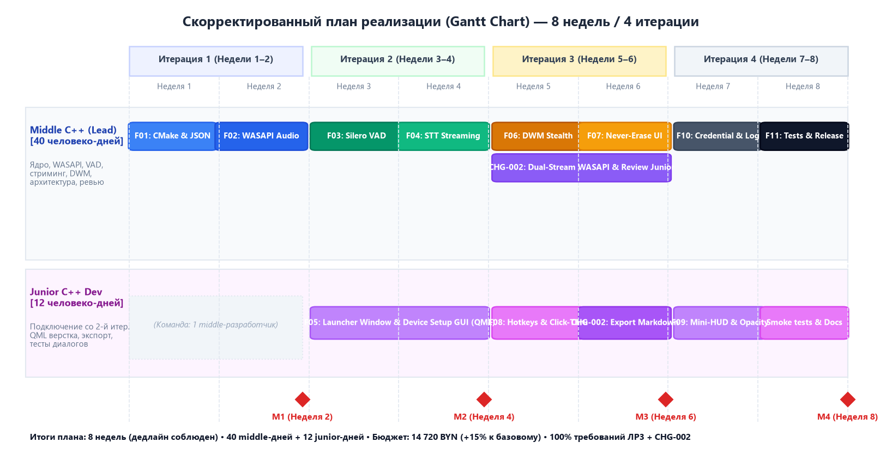

# Дорожная карта проекта, приоритизация функций и управление изменениями

## Проект: «Система синхронного перевода для созвонов» (Elor C++)
**Учебная дисциплина:** Жизненный цикл разработки программного обеспечения (ЖЦРПО)  
**Автор:** Бышкало В.П. (гр. 450503)  
**Заказчик:** Равковский А.В. (гр. 450503)  
**Версия плана:** P2 (Итоговый согласованный план)  

---

## 1. Реестр инженерных функций и шкала приоритизации (10–50)

Функции декомпозированы на английском языке в соответствии с методическими требованиями. Приоритет ранжируется по шкале от 10 (критический MVP) до 50 (экспериментальный):

| ID | Function Name (English) | Priority (10-50) | Estimate (Middle Days) | Dependencies | Description |
|---|---|---|---|---|---|
| **F01** | WASAPI Loopback Capture Service | 10 | 5 | - | Low-level Core Audio capture & 16kHz mono resampling |
| **F02** | Silero VAD Voice Detection Engine | 10 | 4 | F01 | ONNX Runtime CPU inference, speech chunk segmentation |
| **F03** | Gemini Live WebSocket Translation Client | 10 | 5 | F02 | Asynchronous streaming STT & real-time translation |
| **F04** | DWM Stealth Subtitle Overlay Window | 20 | 4 | F03 | Qt Quick Topmost overlay with WDA_EXCLUDEFROMCAPTURE |
| **F05** | Never-Erase Subtitle Tape Model | 20 | 3 | F04 | Immutable turn history, card animations |
| **F06** | Click-Through & Hotkeys Controller | 30 | 3 | F04 | WS_EX_TRANSPARENT toggle via Ctrl+Alt+T, global hotkeys |
| **F07** | Mini-HUD Compact Status Bar | 30 | 2 | F04, F02 | 86px floating widget with VAD and latest turn text |
| **F08** | Windows Credential Manager Security | 30 | 2 | - | DPAPI encrypted token storage for API keys |
| **F09** | Technical Glossary Ingestion Cache | 40 | 3 | F03 | Custom domain vocabulary injection via std::unordered_map |
| **F10** | Dual-Stream Dialogue Audio Capture | 20 | 4 | F01, F02 | **CHG-002:** Microphone + Speaker capture with speaker separation |
| **F11** | Automatic Transcript Exporter (MD/TXT) | 20 | 3 | F10, F05 | **CHG-002:** Timestamped session export to Markdown and TXT |

---

## 2. Эволюция планов разработки (P0 → P1 → P2)

### 2.1 План P0: Первичный расчет трудоемкости
- **Трудоемкость:** 47 человеко-дней middle-разработчика при однопоточной разработке.
- **Ставка разработчика:** 40 BYN/час = 320 BYN/день.
- **Бюджет:** 47 × 320 = 15 040 BYN.
- **Дедлайн Заказчика:** 8 календарных недель (40 номинальных рабочих дней).
- **Коллизия:** Дефицит 7 рабочих дней (срыв директивного срока релиза).

### 2.2 План P1: Первый раунд согласования (Инженерная оптимизация)
В ходе переговоров Заказчик отказался урезать функционал. Исполнитель провел технический аудит и предложил решения:
1. Замена самописного нейросетевого инференса на готовый рантайм ONNX Runtime CPU (-1 день);
2. Использование проверенного WebSocket-клиента Boost.Beast вместо кастомного TCP-сокета (-2 дня);
3. Применение стандартных UI-примитивов Qt Quick Controls для окон Launcher и HUD (-2 дня);
4. Кэширование глоссария в `std::unordered_map` с O(1) доступом (-2 дня).
- **Итоговая трудоемкость P1:** ровно **40 человеко-дней** (8 недель).
- **Бюджет P1:** 40 × 320 = **12 800 BYN** (экономия 2 240 BYN).

### 2.3 План P2: Второй раунд согласования (Новое требование CHG-002)
Заказчик добавил критическое бизнес-требование **CHG-002** (двусторонний перевод и автоэкспорт стенограмм звонка: функции F10 и F11, +7 человеко-дней).
- **Управленческое решение:** Сдвиг дедлайна недопустим. Принято решение привлечь со второй итерации **Junior C++ разработчика** (ставка 20 BYN/час = 160 BYN/день на 12 рабочих дней).
- **Распределение обязанностей:**
  - **Middle Lead:** низкоуровневые тракты WASAPI, Silero VAD, DWM оверлей, WebSocket клиент, двухпоточный микшер.
  - **Junior Dev:** верстка окна настроек QML, экспорт стенограмм в Markdown/TXT, модульные тесты парсеров.
- **Параметры плана P2:**
  - Трудоемкость Middle: 40 дней (12 800 BYN);
  - Трудоемкость Junior: 12 дней (1 920 BYN);
  - **Итоговый бюджет P2:** **14 720 BYN** (+15% к базовому);
  - **Срок релиза:** **строго 8 календарных недель** (дедлайн соблюден!).

---

## 3. Скорректированная дорожная карта (Диаграмма Ганта)

*Рисунок 3.1 — Распределение инженерных задач между Middle и Junior разработчиками по спринтам и контрольным точкам*

### Контрольные точки проекта (Milestones):
- **M1 (Конец спринта 1, Неделя 2):** Захват аудио WASAPI Loopback в буфер без потерь пакетов, базовый Launcher.
- **M2 (Конец спринта 2, Неделя 4):** Инференс Silero VAD на ONNX Runtime, стриминг реплик по WebSocket, подключение Junior.
- **M3 (Конец спринта 3, Неделя 6):** Боевой поверхностный стелс-оверлей DWM с инвариантом Never-Erase, Click-Through, Mini-HUD.
- **M4 (Конец спринта 4, Неделя 8):** Финальный релиз системы со всеми функциями CHG-002 (двусторонний перевод, экспорт стенограмм).

---

## 4. Реестр рисков и превентивные меры

| ID | Риск | Вероятность | Влияние | Меры превентивного реагирования | Индикатор раннего предупреждения |
|---|---|---|---|---|---|
| **R01** | Задержка WebSocket API Gemini превышает 700 мс | Средняя | Высокое | Переход на локальный fallback (Whisper ONNX), сжатие аудио в Opus | Мониторинг латентности в HUD |
| **R02** | Детектор Silero VAD обрезает тихие окончания слов | Низкая | Среднее | Адаптивный порог тишины (`minSilenceMs` 550 мс, `maxSilenceMs` 1200 мс) | Логирование энергии аудиосигнала |
| **R03** | DWM флаг `WDA_EXCLUDEFROMCAPTURE` сбоит в Windows 11 | Низкая | Критическое | Режим черного фона окна и проверка версии DWM при запуске | Автотест захвата через BitBlt |
| **R04** | Утечки памяти в кольцевом буфере при долгих звонках | Средняя | Высокое | Использование RAII, статических пулов памяти и `std::array` | Профайлер MSVC Diagnostic Tools |
| **R05** | Задержки онбординга Junior C++ разработчика | Средняя | Среднее | Готовые CMake пресеты, строгие интерфейсные DTO-контракты | Ревью первого Pull Request в итерации 2 |
| **R06** | Сбой сохранения стенограммы при аварийном завершении | Низкая | Высокое | Атомарная запись во временный файл и сброс на диск (`FlushFileBuffers`) | Проверка целостности файла транскрипта |

---

## 5. Критерии Definition of Ready (DoR) и Definition of Done (DoD)

### Definition of Ready (DoR) для входящих требований:
1. Требование удовлетворяет критериям **INVEST** и оформлено в форме User Story с acceptance criteria (Gherkin);
2. Специфицированы интерфейсные типы данных (C++ DTO) и контракты сообщений IPC;
3. Для требования закрыты архитектурные неопределенности соответствующим протоколом ADR.

### Definition of Done (DoD) для релизного инкремента:
1. Исходный код компилируется без предупреждений (`/W4 /WX` на MSVC);
2. 100% покрытие модульными и контрактными тестами критических модулей (WASAPI, VAD, RingBuffer);
3. Пайплайн GitHub Actions CI завершился успешно;
4. Документация в репозитории (SRS, SDD, ADR, ROADMAP) полностью синхронизирована с кодом.
