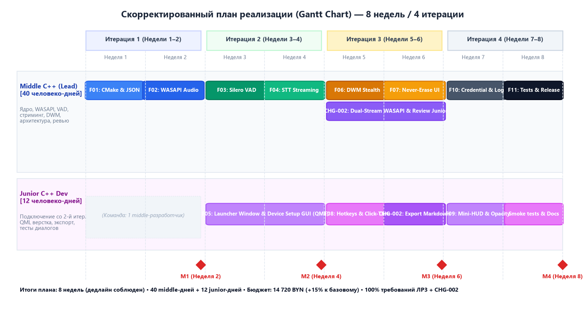

# Дорожная карта проекта, приоритизация функций и управление изменениями

## Проект: «Система синхронного перевода для созвонов» (Elor C++)
**Учебная дисциплина:** Жизненный цикл разработки программного обеспечения (ЖЦРПО)  
**Автор (Исполнитель / Lead C++):** Бышкало В.П. (гр. 450503)  
**Заказчик:** Равковский А.В. (гр. 450503)  
**Версия плана:** P2 (Итоговый согласованный план)  
**Протокол переписки (Раунд 1 и Раунд 2):** [`docs/NEGOTIATIONS.md`](NEGOTIATIONS.md)

---

## 1. Реестр инженерных функций и шкала приоритизации (10–50)

Функции базового скоупа (из SRS) декомпозированы на английском языке в соответствии с методическими требованиями. Приоритет ранжируется по шкале от `10` (наивысший, критический MVP) до `50` (минимальный, экспериментальный):

| ID | Function Name (English) | Priority (10–50) | Estimate (Middle Days) | Dependencies |
|---|---|---|---|---|
| **F01** | Core architecture, CMake presets and local JSON persistence | 10 | 4 | – |
| **F02** | WASAPI loopback audio capture and SPSC ring buffer | 10 | 5 | F01 |
| **F03** | Silero VAD ONNX integration and TurnDetector state machine | 10 | 5 | F02 |
| **F04** | Streaming STT client and real-time translation orchestrator | 10 | 5 | F02, F03 |
| **F05** | Qt Quick / QML launcher window and audio device setup GUI | 20 | 4 | F01 |
| **F06** | DWM stealth overlay window (WDA_EXCLUDEFROMCAPTURE, Topmost) | 10 | 4 | F01 |
| **F07** | Subtitle stream UI with Never-Erase invariant cards | 20 | 4 | F04, F06 |
| **F08** | Global Windows hotkeys and Click-Through toggle (Ctrl+Alt+T) | 30 | 3 | F06 |
| **F09** | Compact Mini-HUD mode (height 86 px) and opacity controls | 30 | 4 | F06, F07 |
| **F10** | Error logging, Credential Manager security and packaging | 10 | 4 | F01, F04 |
| **F11** | End-to-end latency benchmarks contract tests and release | 10 | 5 | Все функции |
| **Итого** | **Базовый скоуп (План P0)** | — | **47 чел.-дн.** | — |

---

## 2. Эволюция планов разработки (P0 → P1 → P2)

### 2.1 Разработанный план P0: Первичный расчёт трудоёмкости
- **Трудоёмкость:** **47 человеко-дней** middle-разработчика при однопоточной разработке.
- **Ставка разработчика:** `40 BYN/час = 320 BYN/день`.
- **Бюджет P0:** `47 × 320 = 15 040 BYN`.
- **Дедлайн Заказчика:** **8 календарных недель** (40 номинальных рабочих дней).
- **Коллизия:** Дефицит **7 рабочих дней** (при однопоточной разработке релиз срывается на 10-ю неделю).

### 2.2 Изменённый план P1: Первый раунд согласования (Инженерная оптимизация)
В первом раунде переговоров Заказчик отказался сдвигать дедлайн и потребовал пояснить трудоёмкость `F02`/`F03`/`F04` и сократить срок на 7 дней без урезания функционала SRS. Исполнитель провёл технический аудит и предложил **5 оптимизаций**:

| Уточнение решения | Экономия | Причина сохранения требований |
|---|---|---|
| Использование готовой модели Silero VAD v4 на ONNX Runtime CPU вместо кастомного DSP | **2 дня** | Высокая точность детекции речи без необходимости трудоёмкой калибровки фильтров |
| Локальный протокол WebSocket JSON-RPC v1 вместо тяжеловесного gRPC/Protobuf | **2 дня** | Упрощение кодовой базы; отсутствие внешних генераторов кода и быстрый обмен `< 2 мс` |
| Кэширование глоссария IT-терминов в памяти через `std::unordered_map` без СУБД | **1 день** | Поиск термина выполняется за `O(1)`; исключены зависимости от внешних баз данных |
| Стандартная компоновка Qt Quick Layouts для карточек субтитров без кастомного шейдинга | **1 день** | Стабильная отрисовка `60 FPS`; ускорение вёрстки компонентов ленты субтитров |
| Прямое файловое журналирование в `app.log` вместо сложного графического окна логов | **1 день** | `REQ-OBS-001` требует фиксации сбоев, но не отдельного перегруженного интерфейса |

- **Итоговая трудоёмкость P1:** `47 - 7 =` **40 человеко-дней** (ровно **8 недель**, **4 двухнедельные итерации**).
- **Бюджет P1:** `40 × 320 =` **12 800 BYN** (экономия `2 240 BYN`).

#### Распределение по 4 итерациям (План P1):
| Итерация | Результат | Функции | Контрольная точка |
|---|---|---|---|
| **1, недели 1–2** | Каркас CMake, JSON персистентность, захват WASAPI Loopback, SPSC буфер | F01, F02 | **M1:** звук звонка стабильно перехватывается в буфер |
| **2, недели 3–4** | Silero VAD на ONNX Runtime, TurnDetector, стриминговый клиент перевода, Launcher | F03, F04, F05 | **M2:** сквозной стриминг распознавания и перевода |
| **3, недели 5–6** | Стелс-оверлей DWM, защита от захвата экрана, лента Never-Erase, хоткеи | F06, F07, F08 | **M3:** плавающий оверлей субтитров поверх видеозвонка |
| **4, недели 7–8** | Режим Mini-HUD, регулировка прозрачности, Credential Manager, бенчмарки, релиз | F09, F10, F11 | **M4:** готовая версия 1.0 к установленному дедлайну |

### 2.3 Согласованный план P2: Второй раунд согласования (Новое требование CHG-002)
Во втором раунде переговоров Заказчик выдвинул критическое бизнес-требование **CHG-002** (приоритет **20**):
1. Двусторонний перевод диалога `RU ↔ EN` с одновременным захватом собственного микрофона пользователя (`WASAPI Mic Capture` — 2 дня) и разделением ролей `me / interlocutor` (1 день);
2. Автоматический экспорт полной стенограммы созвона с таймкодами в форматы **Markdown (`.md`)** и **TXT** с UTF-8 BOM (экспорт — 2 дня, доработка UI и интеграционные тесты — 2 дня).

- **Трудоёмкость CHG-002:** **+7 middle-дней**.
- **Управленческое решение:** Предложение сдвинуть релиз на 10-ю неделю Заказчик категорически отклонил. Согласован компромисс — привлечение со **2-й итерации Junior C++ разработчика** (ставка `20 BYN/час = 160 BYN/день`, **12 рабочих дней**, стоимость `1 920 BYN`).
- **Перераспределение задач:**
  - **Middle Lead (`35` дней прямой разработки задач + координация/код-ревью в рамках 8-недельного цикла):** ядро WASAPI Loopback и **WASAPI Mic Capture (CHG-002)**, SPSC-буфер, Silero VAD, потоковый Gemini STT, разделение спикеров `me / interlocutor`, оверлей DWM, `Never-Erase`, бенчмарки латентности.
  - **Junior C++ (`12` дней со 2-й итерации):** вёрстка окна настроек Launcher QML (`F05`), настройки хоткеев/Mini-HUD (`F08`/`F09`), модуль **автоэкспорта стенограммы в Markdown/TXT (`CHG-002`)**, модульные тесты парсеров и экспортёра.
- **Итоговые параметры плана P2:**
  - Объём работ: **47 чел.-дн.** (`35` Middle Lead на прямые задачи + `12` Junior C++, при 40-дневном календарном цикле Lead с ревью);
  - **Итоговый бюджет P2:** **14 720 BYN** (`+15 %` к базовому `12 800 BYN`);
  - **Длительность проекта:** **строго 8 календарных недель (4 итерации, дедлайн сохранён)**.

#### Сравнение планов после первого и второго раундов

| Показатель | План после раунда 1 (P1) | План после раунда 2 (P2) |
|---|---|---|
| Объём работ, чел.-дн. | 40 (только Middle Lead) | **47** (35 Middle Lead + 12 Junior C++) |
| Длительность проекта | 8 недель (4 спринта) | **8 недель (4 спринта — дедлайн сохранён)** |
| Состав команды | 1 Middle C++ разработчик | **1 Middle (Lead) + 1 Junior (со спринта 2)** |
| Включённый объём требований | Базовый скоуп SRS ЛР3 (`F01–F11`) | Базовый скоуп + требование **CHG-002** (двусторонний перевод и экспорт стенограммы) |
| Стоимость разработки, BYN | 12 800 (40 дней × 320 BYN) | **14 720** (+15 % к базовому за счёт подключения Junior C++) |
| Итоговое решение | План согласован, но дефицит резерва | **Итоговый утверждённый производственный план** |

---

## 3. Скорректированная дорожная карта (Диаграмма Ганта)

*Рисунок 3.1 — Распределение инженерных задач между Middle (Lead) и Junior разработчиками по 4 итерациям и контрольным точкам M1–M4*

### Контрольные точки проекта (Milestones):
- **M1 (Конец итерации 1, Неделя 2):** Захват аудио WASAPI Loopback в буфер без потерь пакетов, базовый каркас CMake.
- **M2 (Конец итерации 2, Неделя 4):** Инференс Silero VAD на ONNX Runtime, стриминг реплик по WebSocket, Launcher GUI, подключение Junior.
- **M3 (Конец итерации 3, Неделя 6):** Боевой поверхностный стелс-оверлей DWM с инвариантом Never-Erase, Click-Through, Mini-HUD.
- **M4 (Конец итерации 4, Неделя 8):** Финальный релиз системы со всеми функциями CHG-002 (двусторонний перевод, автоэкспорт стенограмм Markdown/TXT).

---

## 4. Реестр рисков и превентивные меры

| Риск | Вероятность / Влияние | Мера реагирования | Сигнал раннего предупреждения |
|---|---|---|---|
| Несовместимость WASAPI Loopback с нестандартными аудиокартами Realtek/Bluetooth | Средняя / высокое | Использование `IAudioClient3` с автоматическим fallback на системный Default Render Device | Ошибки `AUDCLNT_E_DEVICE_INVALIDATED` в логах |
| Превышение лимита задержки распознавания речи из-за сетевых флуктуаций (Jitter) | Высокая / высокое | Стриминг аудио по устойчивому WebSocket с локальной буферизацией фреймов | Метрика p95 задержки превышает порог 1200 мс |
| Ложные срабатывания VAD на фоновом шуме микрофона и дыхании пользователя | Средняя / среднее | Калибровка порога уверенности Silero VAD (0.6) и фильтрация тишины длительностью `< 120 мс` | Генерация пустых или фрагментарных субтитров |
| Блокировка флага `WDA_EXCLUDEFROMCAPTURE` сторонними антивирусами или обновлениями Windows 11 | Низкая / критическое | Резервный режим маскировки через прозрачный layered window с альфа-каналом DWM | Скриншот экрана захватывает контур оверлея |
| Искажение кириллицы при автоэкспорте стенограммы созвона | Высокая / среднее | Обязательная запись сигнатуры UTF-8 BOM (`\xEF\xBB\xBF`) в Markdown и TXT | Нечитаемые символы при открытии файла в блокноте |
| Снижение производительности GPU из-за динамической перерисовки ленты субтитров | Средняя / среднее | Инвариант Never-Erase: ранее отрендеренные карточки кешируются и не перерисовываются | Частота кадров интерфейса оверлея падает ниже 60 FPS |
| Срыв сроков задач Junior-разработчиком в итерациях 2–3 | Средняя / высокое | Декомпозиция задач Junior до квантов `≤ 1 день` и обязательный ежедневный Code Review Lead | Отсутствие открытого Pull Request к середине недели |

---

## 5. Критерии Definition of Ready (DoR) и Definition of Done (DoD)

### Definition of Ready (DoR) для входящих требований:
1. Требование удовлетворяет критериям **INVEST** и оформлено в форме User Story с acceptance criteria (Gherkin);
2. Специфицированы интерфейсные типы данных (C++ DTO) и контракты сообщений IPC;
3. Для требования закрыты архитектурные неопределённости соответствующим протоколом ADR.

### Definition of Done (DoD) для релизного инкремента:
1. Исходный код компилируется без предупреждений (`/W4 /WX` на MSVC);
2. 100% покрытие модульными и контрактными тестами критических модулей (WASAPI, VAD, RingBuffer);
3. Пайплайн GitHub Actions CI завершился успешно;
4. Документация в репозитории (SRS, SDD, ADR, ROADMAP, NEGOTIATIONS) полностью синхронизирована с кодом.
