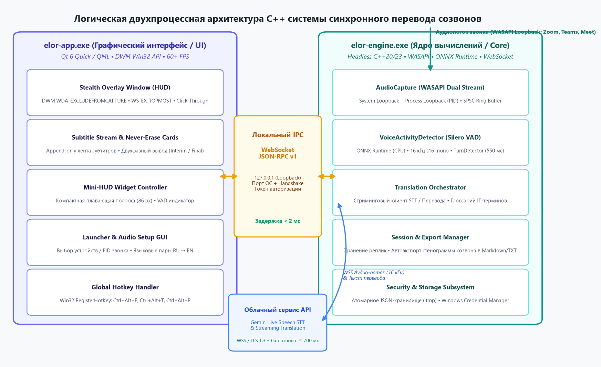

# Описание архитектурного дизайна программного обеспечения (SDD)

## Проект: «Система синхронного перевода для созвонов» (Elor C++ Call Translator)

**Версия:** 1.0  
**Статус:** Утверждено (Approved)  
**Дата:** 2026-11-10  
**Автор (Ведущий архитектор):** Бышкало Владислав Павлович (студент группы 450503)  
**Заказчик (Рецензент):** Равковский Андрей Васильевич (студент группы 450503)  
**Организация:** БГУИР, Факультет компьютерных систем и сетей, Кафедра ЭВМ  
**Дисциплина:** Жизненный цикл разработки программного обеспечения (ЖЦРПО)  
**Репозиторий проекта:** [https://github.com/vodopad-ik/Elor](https://github.com/vodopad-ik/Elor)  
**Учебный репозиторий курса:** [https://github.com/vodopad-ik/SDLC](https://github.com/vodopad-ik/SDLC)  

---

## Оглавление
1. [Введение](#1-введение)
   - 1.1 [Назначение документа](#11-назначение-документа)
   - 1.2 [Область применения](#12-область-применения)
   - 1.3 [Определения и акронимы](#13-определения-и-акронимы)
   - 1.4 [Ссылки и нормативная база](#14-ссылки-и-нормативная-база)
2. [Обзор архитектуры и проектные представления](#2-обзор-архитектуры-и-проектные-представления)
   - 2.1 [Задачи стейкхолдеров и архитектурные драйверы](#21-задачи-стейкхолдеров-и-архитектурные-драйверы)
   - 2.2 [Двухпроцессная модель изоляции (Core & UI)](#22-двухпроцессная-модель-изоляции-core--ui)
   - 2.3 [Архитектурная схема системы](#23-архитектурная-схема-системы)
3. [Декомпозиция кодовой базы (CMake библиотеки)](#3-декомпозиция-кодовой-базы-cmake-библиотеки)
4. [Модель предметных данных](#4-модель-предметных-данных)
5. [Интерфейсы взаимодействия и IPC Протокол](#5-интерфейсы-взаимодействия-и-ipc-протокол)
   - 5.1 [Низкоуровневые C++ контракты](#51-низкоуровневые-c-контракты)
   - 5.2 [Спецификация WebSocket JSON-RPC v1](#52-спецификация-websocket-json-rpc-v1)
6. [Параллелизм, управление памятью и оконный менеджер DWM](#6-параллелизм-управление-памятью-и-оконный-менеджер-dwm)
   - 6.1 [Кольцевой SPSC буфер без блокировок](#61-кольцевой-spsc-буфер-без-блокировок)
   - 6.2 [Оконные стили DWM и инвариант Never-Erase](#62-оконные-стили-dwm-и-инвариант-never-erase)
7. [Реестр архитектурных решений (ADR)](#7-реестр-архитектурных-решений-adr)

---

## 1. Введение

### 1.1 Назначение документа
Настоящий документ «Описание дизайна программного обеспечения» (Software Design Description, SDD) разработан в соответствии с международным стандартом **IEEE 1016-2009** и детализирует архитектурные, модульные, интерфейсные и низкоуровневые инженерные решения десктопного комплекса синхронного перевода для созвонов **«Elor»** (C++23 / Qt 6.8 LTS под ОС Windows 11). Документ связывает спецификацию требований к ПО (SRS, `srs/srs.md`) с физической реализацией кодовой базы.

### 1.2 Область применения
Архитектура охватывает низкоуровневый перехват звука Windows Core Audio (WASAPI Loopback), локальный нейросетевой инференс Silero VAD на рантайме ONNX Runtime CPU, асинхронный стриминг чанков по протоколу WebSocket к облачному API Gemini, отображение карточек субтитров в маскируемом оверлее Desktop Window Manager (DWM) и автоэкспорт стенограмм звонка в Markdown/TXT.

### 1.3 Определения и акронимы
- **SDD** (Software Design Description) — спецификация архитектурного проектирования системы.
- **ADR** (Architectural Decision Record) — протокол архитектурного решения.
- **WASAPI** — Windows Audio Session API.
- **SPSC Ring Buffer** — Single-Producer Single-Consumer кольцевой буфер без взаимных блокировок (lock-free).
- **IPC** (Inter-Process Communication) — межпроцессное взаимодействие.
- **JSON-RPC v1** — легковесный текстовый протокол удаленного вызова процедур поверх сокета.

### 1.4 Ссылки и нормативная база
1. **IEEE 1016-2009** — IEEE Standard for Information Technology — Systems Design — Software Design Descriptions.
2. Спецификация SRS: `srs/srs.md` (проект Elor, версия 0.2).
3. Реестр архитектурных решений: каталог `adr/` (ADR 0001–0006).

---

## 2. Обзор архитектуры и проектные представления

### 2.1 Задачи стейкхолдеров и архитектурные драйверы
- **Субсекундная латентность (Sub-second Latency):** медианное время от конца фразы до перевода ≤ 700 мс.
- **Абсолютная невидимость (Stealth Overlay):** исключение окна оверлея из демонстрации экрана Zoom, Teams, Meet (`WDA_EXCLUDEFROMCAPTURE`).
- **Инвариант Never-Erase:** отображаемый текст не затирается и не прыгает при уточнении гипотез перевода.
- **Изоляция сбоев (Process Decoupling):** тяжелая графика и сеть не блокируют цикл захвата звука.

### 2.2 Двухпроцессная модель изоляции (Core & UI)
Система разделена на два физических процесса, объединенных под управлением Win32 Job Object:
1. **Вычислительное ядро (`elor-engine.exe`):** консольный фоновый процесс реального времени. Отвечает за WASAPI capture, SPSC ring buffer, Silero VAD инференс, формирование речевых сегментов и WebSocket клиент Gemini API.
2. **Графическая оболочка (`elor-app.exe`):** интерфейсный процесс на Qt 6.8 LTS (QML / Qt Quick). Создает прозрачный поверхностный оверлей DWM (`WS_EX_TOPMOST`, `WS_EX_LAYERED`, `WS_EX_NOACTIVATE`, `WS_EX_TRANSPARENT`), визуализирует ленту субтитров и предоставляет диалог настроек (Launcher).

### 2.3 Архитектурная схема системы
Взаимодействие процессов, компонентов и внешних интерфейсов проиллюстрировано на схеме:


*Рисунок 2.1 — Логическая двухпроцессная архитектура программного комплекса Elor*

---

## 3. Декомпозиция кодовой базы (CMake библиотеки)

Кодовая база декомпозирована на 10 независимых CMake-модулей со строгими интерфейсными границами:

| Библиотека / Модуль | Тип | Зона ответственности | Зависимости |
|---|---|---|---|
| `elor_common` | STATIC | Базовые типы, структуры времени, логирование, Windows Credential Store | C++23 STL, Win32 API |
| `elor_audio` | STATIC | Фоновый захват WASAPI Loopback / Process Loopback, ресемплинг 16 кГц | `elor_common`, Core Audio COM |
| `elor_vad` | STATIC | Инференс Silero VAD на ONNX Runtime CPU, классификация фреймов 32 мс | `elor_common`, ONNX Runtime |
| `elor_stt` | STATIC | Потоковый сетевой клиент Google Gemini Live Speech API / Groq Whisper | `elor_common`, Boost.Beast / OpenSSL |
| `elor_turn` | STATIC | Детектор реплик, тайминги пауз коммита (550 мс), инвариант Never-Erase | `elor_common` |
| `elor_prompt` | STATIC | Сборка системных промптов, инжекция терминологического глоссария | `elor_common`, nlohmann_json |
| `elor_llm` | STATIC | Интеграция с LLM-провайдерами, стриминг токенов перевода | `elor_common`, `elor_prompt` |
| `elor_session` | STATIC | Управление сессиями созвона, автоэкспорт стенограммы в Markdown/TXT | `elor_common`, `elor_turn` |
| `elor_api` | STATIC | Локальный WebSocket JSON-RPC v1 сервер/клиент для IPC | `elor_common`, nlohmann_json |
| `elor-engine` | EXE | Вычислительное ядро системы (WASAPI + VAD + STT/LLM + IPC Server) | Все библиотеки `elor_*` |
| `elor-app` | EXE | Пользовательский интерфейс (Qt 6.8 Quick / QML, DWM Overlay, IPC Client) | `elor_api`, `elor_common`, Qt6 |

---

## 4. Модель предметных данных

В оперативной памяти системы циркулируют строго типизированные DTO-структуры:

### 4.1 Структура `AudioChunk`
```cpp
struct AudioChunk {
    int64_t timestamp_ms;              // Монотонная временная метка захвата сэмпла
    uint32_t sample_rate = 16000;       // Частота дискретизации (16 кГц)
    uint16_t channels = 1;              // Монофонический канал
    std::vector<int16_t> pcm_data;      // Размер фрейма строго 512 сэмплов (32 мс)
};
```

### 4.2 Структура `TurnSegment` (Реплика перевода)
```cpp
enum class SpeakerRole { Interlocutor, Me };

struct TurnSegment {
    std::string turn_id;               // Уникальный UUID реплики
    SpeakerRole speaker_role;           // Собеседник или микрофон пользователя
    int64_t start_time_ms;             // Время начала речи
    int64_t end_time_ms;               // Время завершения речи (порог тишины 550 мс)
    bool is_final = false;             // Зафиксирована ли фраза (Never-Erase)
    std::string interim_text;          // Промежуточная гипотеза перевода
    std::string final_translation;     // Окончательный перевод реплики
};
```

### 4.3 Структура `CallSession` (Сессия созвона)
```cpp
struct CallSession {
    std::string session_id;            // Идентификатор сессии звонка
    std::string started_at;            // ISO-8601 время старта
    uint32_t target_pid = 0;           // PID отслеживаемого процесса (Zoom, Teams)
    std::vector<TurnSegment> turns;    // Полная хронологическая лента реплик
    bool auto_export_markdown = true;  // Флаг автоэкспорта при завершении
};
```

---

## 5. Интерфейсы взаимодействия и IPC Протокол

### 5.1 Низкоуровневые C++ контракты
```cpp
class IAudioCaptureService {
public:
    virtual ~IAudioCaptureService() = default;
    virtual bool startCapture(uint32_t target_pid) = 0;
    virtual void stopCapture() = 0;
    virtual bool getNextChunk(AudioChunk& out_chunk) = 0;
};

class IVadDetector {
public:
    virtual ~IVadDetector() = default;
    virtual float processFrame(const AudioChunk& chunk) = 0; // Возвращает вероятность речи [0.0 .. 1.0]
    virtual bool isSpeechActive() const = 0;
};
```

### 5.2 Спецификация WebSocket JSON-RPC v1
Связь между `elor-engine` и `elor-app` осуществляется через локальный сокет `ws://127.0.0.1:49152` с авторизационным заголовком `X-Elor-Token`.

- **Событие активности речи (`vad.speech_state`):**
  ```json
  {"jsonrpc": "2.0", "method": "vad.speech_state", "params": {"active": true, "energy": 0.84}}
  ```
- **Событие промежуточного перевода (`subtitles.interim`):**
  ```json
  {"jsonrpc": "2.0", "method": "subtitles.interim", "params": {"turn_id": "urn:uuid:7a9f", "role": "interlocutor", "text": "Мы планируем релиз на следующей..."}}
  ```
- **Событие финализации реплики Never-Erase (`subtitles.final`):**
  ```json
  {"jsonrpc": "2.0", "method": "subtitles.final", "params": {"turn_id": "urn:uuid:7a9f", "role": "interlocutor", "text": "Мы планируем релиз на следующей неделе.", "latency_ms": 640}}
  ```

---

## 6. Параллелизм, управление памятью и оконный менеджер DWM

### 6.1 Кольцевой SPSC буфер без блокировок
Аудиопоток захватывается аппаратным коллбэком WASAPI в отдельном потоке реального времени с приоритетом `THREAD_PRIORITY_TIME_CRITICAL`. Для передачи фреймов в поток инференса Silero VAD используется структура `SpscRingBuffer<AudioChunk, 64>` на базе атомарных индексов чтения и записи `std::atomic<size_t>` с семантикой `std::memory_order_acquire / release`. Это гарантирует нулевое время ожидания (0 мкс) и исключает потерю аудиопакетов.

### 6.2 Оконные стили DWM и инвариант Never-Erase
- При создании окна оверлея вызываются системные функции Win32:
  ```cpp
  SetWindowLong(hwnd, GWL_EXSTYLE, WS_EX_TOPMOST | WS_EX_LAYERED | WS_EX_TOOLWINDOW | WS_EX_NOACTIVATE);
  SetWindowDisplayAffinity(hwnd, WDA_EXCLUDEFROMCAPTURE);
  ```
- По нажатию хоткея `Ctrl+Alt+T` динамически добавляется флаг `WS_EX_TRANSPARENT` для обеспечения сквозного клика (Click-Through).
- По нажатию хоткея `Ctrl+Alt+H` геометрия окна плавно анимируется в Mini-HUD высотой 86 px.

---

## 7. Реестр архитектурных решений (ADR)

| Код ADR | Название архитектурного решения | Статус | Файл протокола |
|---|---|---|---|
| **ADR-0001** | Выбор целевой операционной системы Windows 11 x64 | Принято | `adr/0001-target-os-windows.md` |
| **ADR-0002** | Двухпроцессная архитектура с изоляцией ядра и интерфейса | Принято | `adr/0002-engine-as-separate-process.md` |
| **ADR-0003** | Технологический стек: современный C++23 и Qt 6.8 LTS (QML) | Принято | `adr/0003-cpp-qt-stack.md` |
| **ADR-0004** | Выбор облачного ИИ-провайдера потокового перевода (Gemini Live) | Принято | `adr/0004-cloud-ai-gemini-first.md` |
| **ADR-0005** | Алгоритм детекции пауз Silero VAD и инвариант Never-Erase | Принято | `adr/0005-turn-detection-and-never-erase.md` |
| **ADR-0006** | Механизм фонового скринкапчура и мультимодального анализа контекста | Принято | `adr/0006-screen-capture-and-multimodal-vision.md` |
