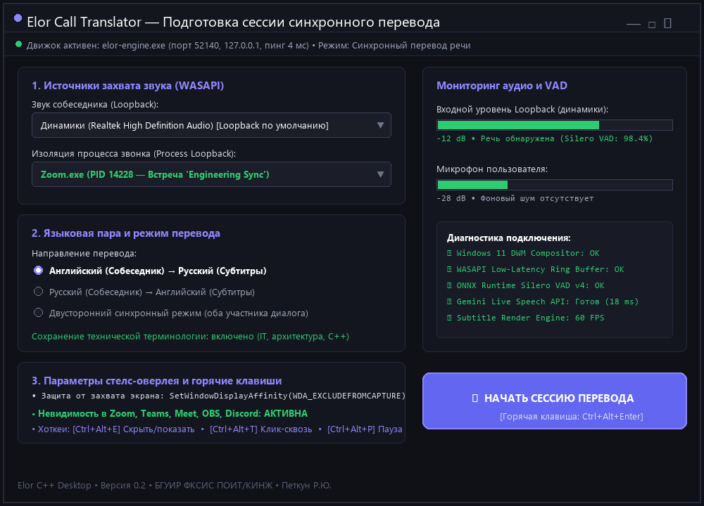
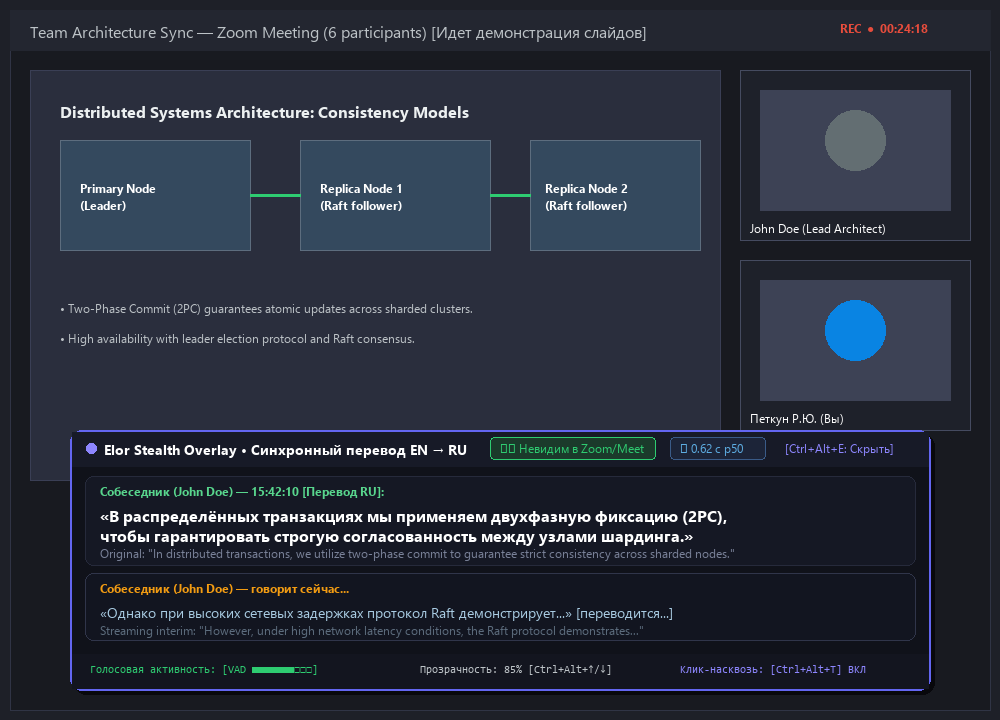
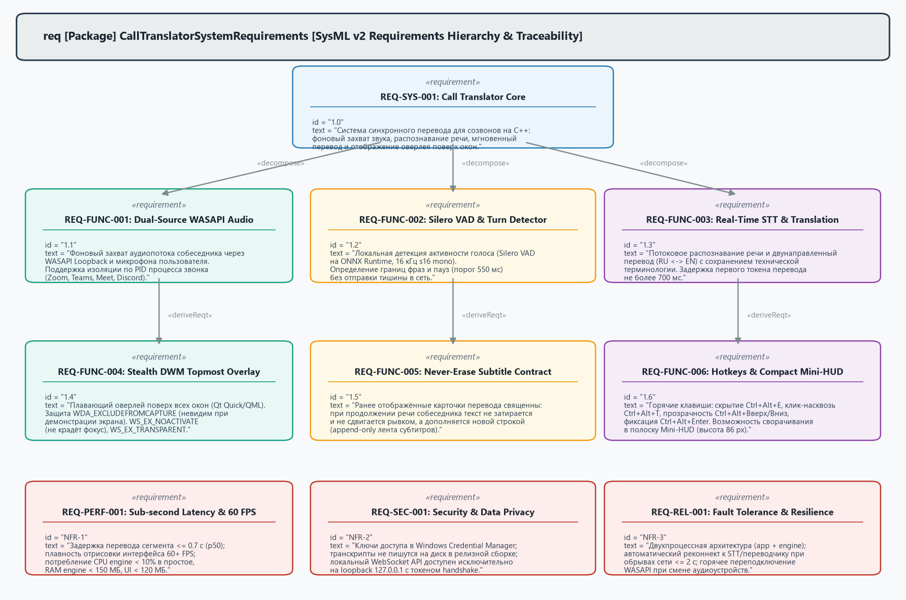
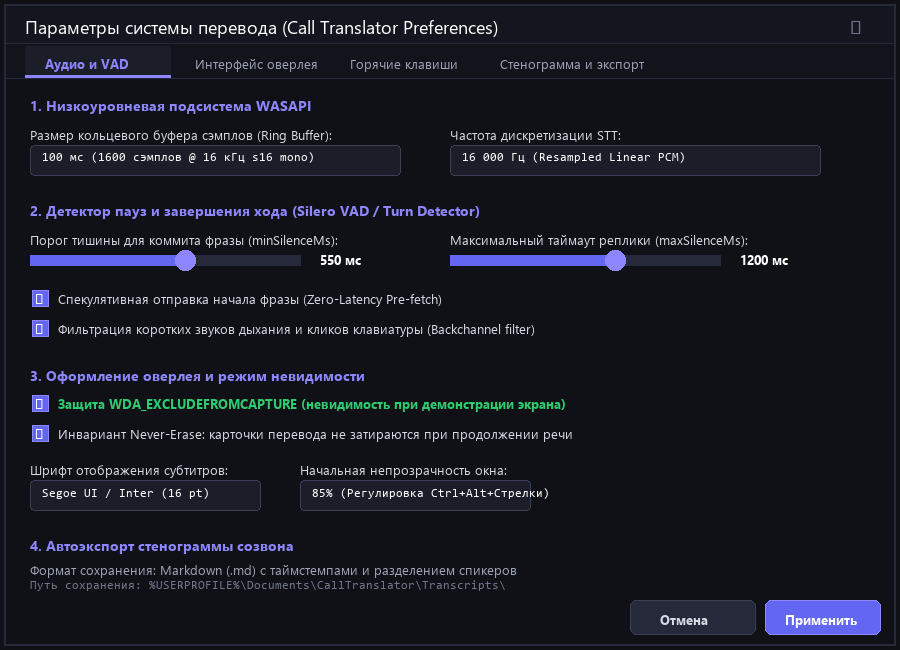

# Спецификация требований к программному обеспечению (SRS)

## Проект: «Система синхронного перевода для созвонов» (Elor C++ Call Translator)

**Версия:** 0.2  
**Статус:** Согласовано (Approved)  
**Дата:** 2026-10-27  
**Автор (Менеджер проекта / Аналитик):** Бышкало Владислав Павлович (студент группы 450503)  
**Заказчик (Рецензент):** Равковский Андрей Васильевич (студент группы 450503)  
**Организация:** БГУИР, Факультет компьютерных систем и сетей, Кафедра ЭВМ  
**Дисциплина:** Жизненный цикл разработки программного обеспечения (ЖЦРПО)  
**Репозиторий проекта:** [https://github.com/vodopad-ik/Elor](https://github.com/vodopad-ik/Elor)  
**Учебный репозиторий курса:** [https://github.com/vodopad-ik/SDLC](https://github.com/vodopad-ik/SDLC)  

---

## Оглавление
1. [Введение](#1-введение)
   - 1.1 [Назначение документа](#11-назначение-документа)
   - 1.2 [Область применения продукта](#12-область-применения-продукта)
   - 1.3 [Определения, акронимы и сокращения](#13-определения-акронимы-и-сокращения)
   - 1.4 [Ссылки и нормативная база](#14-ссылки-и-нормативная-база)
   - 1.5 [Краткий обзор](#15-краткий-обзор)
2. [Общее описание системы](#2-общее-описание-системы)
   - 2.1 [Перспектива продукта и контекст](#21-перспектива-продукта-и-контекст)
   - 2.2 [Классы и характеристики пользователей](#22-классы-и-характеристики-пользователей)
   - 2.3 [Эксплуатационные ограничения](#23-эксплуатационные-ограничения)
   - 2.4 [Допущения и зависимости](#24-допущения-и-зависимости)
3. [Внешние интерфейсы системы](#3-внешние-интерфейсы-системы)
   - 3.1 [Пользовательские интерфейсы (GUI Мокапы)](#31-пользовательские-интерфейсы-gui-мокапы)
   - 3.2 [Аппаратные и системные интерфейсы](#32-аппаратные-и-системные-интерфейсы)
   - 3.3 [Программные интерфейсы и протоколы](#33-программные-интерфейсы-и-протоколы)
4. [Системное моделирование требований (SysML v2)](#4-системное-моделирование-требований-sysml-v2)
5. [Функциональные требования](#5-функциональные-требования)
6. [Нефункциональные требования (Атрибуты качества)](#6-нефункциональные-требования-атрибуты-качества)
   - 6.1 [Требования к производительности (Performance)](#61-требования-к-производительности-performance)
   - 6.2 [Требования к безопасности и конфиденциальности (Security)](#62-требования-к-безопасности-и-конфиденциальности-security)
   - 6.3 [Требования к надежности (Reliability)](#63-требования-к-надежности-reliability)
   - 6.4 [Требования к сопровождаемости и переносимости](#64-требования-к-сопровождаемости-и-переносимости)
7. [Матрица трассируемости и верификации](#7-матрица-трассируемости-и-верификации)
8. [История изменений и согласование (Pull Request)](#8-история-изменений-и-согласование-pull-request)

---

## 1. Введение

### 1.1 Назначение документа
Настоящая спецификация требований к программному обеспечению (Software Requirements Specification, SRS) описывает функциональные и нефункциональные требования к программному комплексу синхронного перевода речи для видеоконференций и звонков в реальном времени **«Elor» (Real-time Call Translator)**. Документ служит единым нормативно-техническим соглашением между Заказчиком и командой разработки, определяя критерии приемки, границы системы и методы верификации.

### 1.2 Область применения продукта
Программный комплекс **Elor** представляет собой высокопроизводительное настольное приложение для операционной системы Windows 11 x64, функционирующее в фоновом режиме во время звонков в коммуникационных сервисах (Zoom, Microsoft Teams, Google Meet, Яндекс Телемост, Discord, Telegram Desktop). Приложение перехватывает аудиопоток собеседника без внедрения в чужие процессы (DLL injection), выполняет локальную детекцию голосовой активности (Silero VAD), направляет аудиосегменты в облачный потоковый ИИ-сервис (Gemini Live Speech API) и выводит синхронный текстовый перевод в виде ненавязчивого поверхностного стелс-оверлея с аппаратной защитой от попадания в трансляцию экрана (`WDA_EXCLUDEFROMCAPTURE`).

### 1.3 Определения, акронимы и сокращения
- **WASAPI** (Windows Audio Session API) — низкоуровневый интерфейс аудиоподсистемы Windows Core Audio.
- **Loopback Capture** — режим перехвата звука, воспроизводимого динамиками или конкретным приложением.
- **Process Loopback** — перехват звука конкретного процесса звонка по его Process Identifier (PID).
- **VAD** (Voice Activity Detection) — детектор голосовой активности; алгоритм отделения речи от пауз и фонового шума.
- **Silero VAD** — компактная предобученная нейросетевая модель детекции речи, работающая через рантайм ONNX Runtime CPU.
- **STT** (Speech-to-Text) — потоковое распознавание устной речи в текст.
- **Never-Erase** — фундаментальный инвариант отображения оверлея: ранее выведенные реплики и карточки субтитров никогда не затираются промежуточными гипотезами перевода, а дополняются новыми карточками.
- **DWM** (Desktop Window Manager) — оконный менеджер рабочего стола Windows.
- **Click-Through** — режим сквозного пропуска кликов мыши сквозь окно оверлея в нижележащие приложения (`WS_EX_TRANSPARENT`).
- **Mini-HUD** — режим ультракомпактного плавающего виджета оверлея (высота 86 px).

### 1.4 Ссылки и нормативная база
1. **ISO/IEC/IEEE 29148:2018** — Systems and software engineering — Life cycle processes — Requirements engineering.
2. **IEEE 830-1998** — IEEE Recommended Practice for Software Requirements Specifications.
3. **СТП 01-2024** — Стандарт университета БГУИР. Общие требования к оформлению текстовых студенческих работ.
4. Документация Windows Core Audio: [WASAPI Loopback Capture](https://learn.microsoft.com/en-us/windows/win32/coreaudio/loopback-recording).

### 1.5 Краткий обзор
Спецификация состоит из 8 разделов: концепция продукта, внешние интерфейсы с мокапами GUI, нотация требований SysML v2, детальные требования, атрибуты качества, матрица проверки и протокол рецензирования в GitHub Pull Request.

---

## 2. Общее описание системы

### 2.1 Перспектива продукта и контекст
Традиционные инструменты перевода (браузерные переводчики, онлайн-словари) требуют ручного ввода или копирования текста, что физически невозможно во время живого диалога. Существующие боты для конференций требуют добавления в звонок, информируют участников и не гарантируют конфиденциальность. Комплекс **Elor** решает эту проблему как полностью локальный фоновый ассистент, перехватывающий системный аудиопоток и выводящий перевод прямо перед глазами пользователя в невидимом для посторонних слое.

```
+-------------------------------------------------------------------------+
|                              WINDOWS 11 DWM                             |
|                                                                         |
|   +-----------------------+               +-------------------------+   |
|   |  Целевой видеозвонок  |               |  Стелс-оверлей субтитров |   |
|   |  (Zoom, Teams, Meet)  |               |      (elor-app.exe)     |   |
|   +-----------+-----------+               +------------+------------+   |
|               | (Аудиопоток)                           ^                |
|               v                                        | (JSON-RPC IPC) |
|   +-----------+----------------------------------------+------------+   |
|   |            Вычислительное ядро фонового сервиса                |   |
|   |                      (elor-engine.exe)                          |   |
|   |  - WASAPI Process Loopback    - Silero VAD (ONNX CPU)          |   |
|   |  - Lock-free Ring Buffer      - Gemini Live WebSocket Client    |   |
|   +------------------------------------+----------------------------+   |
+----------------------------------------|--------------------------------+
                                         | (TLS WebSocket)
                                         v
                      +--------------------------------------+
                      |    Облачный ИИ-провайдер Gemini     |
                      |     (Потоковый STT и перевод)        |
                      +--------------------------------------+
```

### 2.2 Классы и характеристики пользователей
- **IT-инженеры и разработчики:** участвуют в международных митингах (Daily, Planning, 1-on-1, Code Review), сталкиваются со специфической терминологией и быстрым темпом речи носителей языка.
- **Студенты и исследователи:** слушают международные лекции, конференции и вебинары на английском языке с синхронным выводом перевода на русский язык.

### 2.3 Эксплуатационные ограничения
1. Целевая операционная система: Windows 11 (билд 22H2 и новее), архитектура x86-64.
2. Сетевое подключение: постоянное широкополосное интернет-соединение (пинг до Google Cloud API < 120 мс, пропускная способность от 512 кбит/с).
3. Аппаратные требования: процессор с поддержкой инструкций AVX2 (Intel Core i3 8-го поколения / AMD Ryzen 3000 и выше), оперативная память не менее 8 ГБ.

### 2.4 Допущения и зависимости
- Поддержка оконным менеджером флага `SetWindowDisplayAffinity(hwnd, WDA_EXCLUDEFROMCAPTURE)`.
- Наличие валидного API-ключа Google Gemini в безопасном хранилище учетных записей Windows Credential Manager.

---

## 3. Внешние интерфейсы системы

### 3.1 Пользовательские интерфейсы (GUI Мокапы)

#### 3.1.1 Окно запуска и диагностики (Launcher)
Главное окно настройки сессии перевода позволяет выбрать целевой процесс звонка, языковую пару, откалибровать чувствительность микрофона и проверить состояние сетевого подключения к ИИ-провайдеру.


*Рисунок 3.1 — Окно предварительной настройки параметров аудиоподсистемы и сессии*

#### 3.1.2 Боевой поверхностный оверлей субтитров (Overlay)
Полупрозрачное окно поверх всех окон с бейджем «Stealth Active», индикатором задержки, лентой субтитров с инвариантом Never-Erase и кнопками быстрого управления.


*Рисунок 3.2 — Графический интерфейс боевого оверлея субтитров во время созвона*

### 3.2 Аппаратные и системные интерфейсы
- **Windows Core Audio (WASAPI):** интерфейсы `IMMDeviceEnumerator`, `IAudioClient`, `IAudioCaptureClient` в режиме `AUDCLNT_STREAMFLAGS_LOOPBACK`.
- **DWM Compositor:** оконные стили `WS_EX_TOPMOST | WS_EX_TOOLWINDOW | WS_EX_NOACTIVATE | WS_EX_LAYERED`.

### 3.3 Программные интерфейсы и протоколы
- **Межпроцессное взаимодействие (IPC):** локальный WebSocket JSON-RPC v1 по адресу `127.0.0.1:49152` с токеном взаимной аутентификации.
- **Внешний ИИ-протокол:** двунаправленный потоковый WebSocket к `generativelanguage.googleapis.com` с передачей аудио чанками 16 кГц 16-бит моно PCM.

---

## 4. Системное моделирование требований (SysML v2)

Для наглядного представления иерархии требований, декомпозиции и связей трассировки спроектированы системные диаграммы в нотации SysML v2:


*Рисунок 4.1 — Иерархия требований и трассировка подсистем (SysML v2)*


*Рисунок 4.2 — Системная диаграмма взаимодействия компонентов при обработке речи*

---

## 5. Функциональные требования

| Идентификатор | Название требования | Описание | Приоритет |
|---|---|---|---|
| **REQ-FUNC-001** | Захват аудио (WASAPI Loopback & Process Loopback) | Система обязана перехватывать входящий аудиопоток созвона как в общем режиме воспроизведения (System Loopback), так и с изоляцией звука конкретного процесса по PID (Zoom, Teams, Meet). Частота дискретизации — 16000 Гц, 16 бит, моно. | Критический (10) |
| **REQ-FUNC-002** | Локальная детекция пауз и речи (Silero VAD) | Система обязана в реальном времени анализировать аудиофреймы размером 32 мс (512 сэмплов) нейросетью Silero VAD на рантайме ONNX Runtime CPU. При пороге вероятности речи ≥ 0.6 аудио направляется в буфер реплики; при паузе более 550 мс реплика финализируется. | Критический (10) |
| **REQ-FUNC-003** | Потоковый ИИ-перевод (Real-time Translation) | Система обязана передавать речевые сегменты по защищенному WebSocket-каналу в сервис перевода и получать субсекундный перевод реплик с сохранением IT-контекста и терминологии диалога. | Критический (10) |
| **REQ-FUNC-004** | Инвариант отображения субтитров «Never-Erase» | Система обязана отображать перевод в виде хронологической ленты карточек. Ранее отображенный и прочитанный пользователем текст запрещено затирать промежуточными версиями гипотез ИИ. | Высокий (20) |
| **REQ-FUNC-005** | Защита от захвата экрана (Stealth Overlay) | Окно субтитров обязано иметь атрибут `SetWindowDisplayAffinity(hwnd, WDA_EXCLUDEFROMCAPTURE)`, полностью исключающий его попадание в скриншоты, запись экрана и демонстрацию рабочего стола в приложениях конференций. | Высокий (20) |
| **REQ-FUNC-006** | Режим компактного виджета (Mini-HUD) | По нажатию хоткея или клику система трансформирует оверлей в минималистичную плавающую строку высотой 86 px с индикатором VAD и отображением текущей переводимой фразы. *(Включено по замечанию Заказчика v0.2)* | Средний (30) |
| **REQ-FUNC-007** | Кэширование терминологического глоссария | Пользователь имеет возможность задать пользовательский список профессиональных терминов (до 100 пар), инжектируемый в системный промпт ИИ для предотвращения искажения названий библиотек и протоколов. | Средний (30) |
| **REQ-FUNC-008** | Сквозной клик мышью (Click-Through) | По хоткею `Ctrl+Alt+T` оверлей переводится в режим `WS_EX_TRANSPARENT`, позволяя пользователю кликать сквозь текст субтитров в код IDE или презентацию. *(Включено по замечанию Заказчика v0.2)* | Высокий (20) |
| **REQ-FUNC-009** | Управление глобальными хоткеями | Система регистрирует глобальные комбинации клавиш Windows `RegisterHotKey`: `Ctrl+Alt+S` (скрыть/показать оверлей), `Ctrl+Alt+T` (клик-сквозь), `Ctrl+Alt+H` (Mini-HUD), `Ctrl+Alt+C` (очистка ленты). | Средний (30) |

---

## 6. Нефункциональные требования (Атрибуты качества)

### 6.1 Требования к производительности (Performance)
- **REQ-PERF-001 (Латентность):** Медианная задержка (p50) от момента окончания фразы собеседником до появления финального перевода не должна превышать **700 мс** (95-й перцентиль p95 ≤ 1100 мс).
- **REQ-PERF-002 (Нагрузка CPU):** Суммарная нагрузка фонового вычислительного ядра (elor-engine) на CPU не должна превышать **5%** на современных 4-ядерных процессорах.
- **REQ-PERF-003 (Плавность GUI):** Графический интерфейс Qt Quick обязан перерисовываться с частотой не менее **60 кадров/с** без блокировки потока пользовательского ввода.
- **REQ-PERF-004 (Потребление RAM):** Объем оперативной памяти процесса ядра не должен превышать **120 МБ**, процесса графического интерфейса — **95 МБ**.

### 6.2 Требования к безопасности и конфиденциальности (Security)
- **REQ-SEC-001 (Маскирование):** Гарантированная невозможность захвата субтитров посторонними участниками созвона во всех распространенных мессенджерах.
- **REQ-SEC-002 (Шифрование ключей):** Секретные API-ключи провайдеров обязаны сохраняться исключительно в защищенном хранилище `Windows Credential Manager` в зашифрованном виде (DPAPI).
- **REQ-SEC-003 (Приватность звука):** Аудиопоток не сохраняется на постоянный диск в открытом виде и уничтожается из кольцевого буфера памяти сразу после сегментации VAD.

### 6.3 Требования к надежности (Reliability)
- **REQ-REL-001 (Устойчивость к разрывам сети):** При кратковременном обрыве интернет-соединения система осуществляет автоматический реконнект WebSocket с экспоненциальным бэкоффом (1с, 2с, 4с) и оповещением пользователя в статус-баре HUD.
- **REQ-REL-002 (Изоляция сбоев):** Аварийное завершение процесса пользовательского интерфейса (elor-app) не приводит к падению ядра захвата звука (elor-engine).

### 6.4 Требования к сопровождаемости и переносимости
- **REQ-MAINT-001 (Стандарты C++):** Кодовая база ядра пишется на C++23 с флагами компилятора MSVC `/W4 /WX` без использования устаревших конструкций.
- **REQ-PORT-001 (CMake-сборка):** Полная автоматизация сборки с помощью CMake и пакетного менеджера `vcpkg`.

---

## 7. Матрица трассируемости и верификации

| Идентификатор требования | Категория | Метод верификации | Критерий успешного прохождения |
|---|---|---|---|
| REQ-FUNC-001 | Аудиозахват | Тестирование / Демонстрация | Запись чистого синусоидального тона 1 кГц из тестового процесса в буфер без потерь пакетов |
| REQ-FUNC-002 | Silero VAD | Модульное тестирование | Точность обнаружения пауз > 98% на эталонном датасете аудиоклипов со звонков |
| REQ-FUNC-003 | Перевод | Интеграционное тестирование | Ответ от WebSocket API с валидной JSON-RPC структурой за время < 600 мс |
| REQ-FUNC-004 | Never-Erase | Инспекция / UI Тест | Проверка неизменности текста предыдущих карточек модели `SubtitleCardModel` |
| REQ-FUNC-005 | WDA Маскировка | Демонстрация | Захват окна через Zoom Screen Share и Snipping Tool: черная или прозрачная область |
| REQ-FUNC-006 | Mini-HUD | Демонстрация | Высота виджета ровно 86 px, хоткей переключает режим мгновенно |
| REQ-FUNC-008 | Click-Through | Тестирование | Клик мышью в область окна передается в нижележащее окно блокнота/IDE |
| REQ-PERF-001 | Латентность | Нагрузочное тестирование | Автоматический таймстемпинг: среднее время < 700 мс по 100 репликам |
| REQ-SEC-002 | Credential Store | Инспекция кода | Отсутствие открытых токенов в реестре, файлах конфигурации и репозитории Git |

---

## 8. История изменений и согласование (Pull Request)

### Версия 0.1 (2026-10-25)
- Первоначальное формирование спецификации требований на основе ролевой игры «Заказчик — Менеджер проекта».
- Определение базовых границ проекта (Scope), функциональных требований REQ-FUNC-001..005 и атрибутов качества.
- Создание SysML v2 диаграмм и мокапов интерфейса в формате PNG.
- Публикация ветки `feature/lab3-srs` и оформление Pull Request #1 на GitHub.

### Рецензирование Заказчиком (Андрей Равковский в PR #1):
1. *Замечание 1:* Необходима изоляция перехвата звука конкретного приложения звонка по PID (Process Loopback), чтобы не захватывать системные уведомления Windows и музыку.
2. *Замечание 2:* Добавить режим «Click-Through» сквозного пропуска кликов мыши, чтобы оверлей не мешал нажимать кнопки в интерфейсе звонка и коде.
3. *Замечание 3:* Реализовать режим компактного статус-бара (Mini-HUD) для комфортной работы на экранах ноутбуков с ограниченным разрешением.

### Версия 0.2 (2026-10-27) — Принято к реализации:
- Все замечания Заказчика признаны обоснованными и интегрированы в спецификацию:
  - REQ-FUNC-001 дополнен алгоритмом WASAPI Process Loopback по PID процесса;
  - Введено требование REQ-FUNC-006 (Компактный режим Mini-HUD);
  - Введено требование REQ-FUNC-008 (Режим сквозного клика Click-Through);
  - Обновлены матрицы атрибутов качества и трассируемости верификации.
- Изменения зафиксированы коммитом и одобрены в Pull Request #1.
